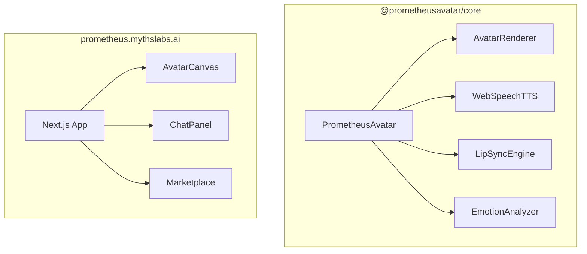

<p align="center">
  <a href="https://prometheus.mythslabs.ai">
    
  </a>
</p>

<h1 align="center">🔥 Prometheus Avatar SDK</h1>

<p align="center">
  <strong>Give your AI an embodied avatar — in 5 lines of code.</strong>
</p>

<p align="center">
  Open-source SDK for driving 2D avatars with any LLM output.<br/>
  Lip-sync · Emotion expressions · Text-to-speech · Bring your own voice engine
</p>

<p align="center">
  <a href="https://prometheus.mythslabs.ai"></a>
</p>

<p align="center">
  <a href="https://prometheus.mythslabs.ai/"></a>
  <a href="https://prometheus.mythslabs.ai/marketplace"></a>
</p>

<p align="center">
  <a href="https://www.npmjs.com/package/@prometheusavatar/core"></a>
  <a href="https://www.npmjs.com/package/@prometheusavatar/mcp-server"></a>
  <a href="https://github.com/myths-labs/prometheus-avatar"></a>
  <a href="https://github.com/myths-labs/prometheus-avatar/actions/workflows/ci.yml"></a>
  
  
  
</p>

<p align="center">
  <a href="https://x.com/MythsLabs"></a>
  <a href="https://linkedin.com/company/mythslabs/"></a>
  <a href="https://x.com/SunshiningDay"></a>
</p>

---

> ### 🌐 **[prometheus.mythslabs.ai](https://prometheus.mythslabs.ai)** — Try the full experience: live avatar chat, marketplace, creator dashboard, and more.

---

## ✨ Features

| Feature | Description |
|---------|-------------|
| 🎭 **2D Avatars** | Draws a 2D model file (`.model3.json`) on a canvas in your page, auto-scaled and centred. The package ships no model: bring your own |
| ⚡ **Real-Time Voice** | Example only: [`examples/live-voice/`](examples/live-voice/) shows microphone capture and a streaming voice connection through a backend you run. It is not part of `@prometheusavatar/core` |
| 🗣️ **Text-to-Speech** | By default the browser's built-in speech synthesis: no key, no request from the SDK, and the voices are the ones installed on the viewer's device (pick one by name with `ttsOptions.voice`; an unknown name falls back to the default voice). For any other voice, a cloned one included, pass your own engine as `ttsEngine` (implement `ITTSEngine`). The SDK ships no such engine and does no voice cloning |
| 👄 **Lip Sync** | Mouth movement while the avatar speaks: estimated from the text with the browser voice, or driven by audio amplitude when your own engine supplies it (`onAudioData`) |
| 😊 **Emotion Engine** | Auto-detect emotions from text → avatar expressions + motions |
| 🎨 **Marketplace** | Browse, buy, and sell avatar skins, voices, effects, and personas |
| 📷 **VTuber Mode** | Demo app only: `apps/demo` has camera face tracking (`FaceTracker.tsx`). It is not part of the SDK |
| 🔌 **Pluggable LLMs** | The SDK defines the `ILLMProvider` interface; [`examples/multi-llm/`](examples/multi-llm/) wires several OpenAI-compatible providers with automatic fallback (bring your own keys). The SDK ships no provider |
| 🤖 **Connect Your Agent** | Plug in any OpenAI-compatible agent — [integration guide](docs/agent-integration.md) |
| 🧩 **MCP Server** | `npx @prometheusavatar/mcp-server` — any MCP client (Claude, GPT, Gemini) gets an avatar |
| 📦 **SDK** | Drop-in `@prometheusavatar/core` for your own apps |

## 🎬 Demo

<p align="center">
  <a href="https://prometheus.mythslabs.ai">
    
  </a>
</p>

- Open the app and type a message — the avatar speaks with emotion + lip sync
- Try different emotions: "I'm so happy!" vs "That's so sad..."

## 🚀 Quick Start

### Install

```bash
npm install @prometheusavatar/core
```

### Usage

```typescript
import { createAvatar } from '@prometheusavatar/core';

// Initialize — loads your model file, TTS, lip-sync, emotion
const avatar = await createAvatar({
  container: document.getElementById('avatar')!,
  modelUrl: 'https://your-cdn.example/models/your-model.model3.json', // a 2D model file you host
});

// Avatar speaks with auto-detected emotion + lip-sync
await avatar.speak('Hello! I\'m your AI assistant. 😊');

// React to emotion changes
avatar.on('emotion:change', ({ result }) => {
  console.log(`Emotion: ${result.emotion} (${result.confidence})`);
});
```

### MCP Server (for AI Agents)

Any MCP-compatible AI client (Claude Desktop, Cursor, etc.) can connect:

```bash
npx @prometheusavatar/mcp-server
```

Or add to `claude_desktop_config.json`:

```json
{
  "mcpServers": {
    "prometheus": {
      "command": "npx",
      "args": ["-y", "@prometheusavatar/mcp-server"]
    }
  }
}
```

17 tools available: `create_avatar`, `set_avatar_state`, `equip_asset`, `generate_asset`, `update_asset`, `generate_image_pro`, `list_marketplace`, `get_avatar_status`, `share_avatar`, `speak`, plus the workspace tools `save_work`, `upsert_task`, `complete_task`, `log_visited_page`, `prometheus_read_workspace`, `prometheus_save_workspace_entry`, `prometheus_get_workspace_operation` (what your agent produces lands in your Prometheus workspace — [setup and standing rules](packages/mcp-server/README.md)).

### 🧚 Agent Skill — summon a companion in one sentence

No MCP server? Any coding agent that reads skills (Claude Code, Codex, and other AgentSkills-compatible agents) can drive an avatar over plain HTTP with the bundled [`prometheus-companion` skill](skills/prometheus-companion/SKILL.md) — your agent creates an avatar, hands you the embed link, and pushes its real task state (thinking / acting / done) to it while it works.

```bash
mkdir -p ~/.claude/skills/prometheus-companion && curl -fsSL https://raw.githubusercontent.com/myths-labs/prometheus-avatar/main/skills/prometheus-companion/SKILL.md -o ~/.claude/skills/prometheus-companion/SKILL.md
```

## 🏗️ Architecture



```
prometheus-avatar/           ← This repo (open-source SDK)
├── packages/
│   ├── sdk/                 # @prometheusavatar/core (npm)
│   │   └── src/
│   │       ├── avatar.ts    # PrometheusAvatar orchestrator
│   │       ├── renderer.ts  # 2D model rendering via PIXI.js
│   │       ├── embed.ts     # Bridge to an avatar embed page (postMessage)
│   │       ├── tts.ts       # Browser speech by default; pluggable TTS engine (ITTSEngine)
│   │       ├── lip-sync.ts  # Audio → mouth shape mapping
│   │       ├── emotion.ts   # Text → emotion detection
│   │       └── types.ts     # TypeScript interfaces
│   └── openclaw-plugin/     # OpenClaw marketplace integration
├── examples/                # Ready-to-run examples
├── docs/                    # API documentation + agent integration guide
└── README.md
```

## 🎭 Model files

`createAvatar` draws the 2D model file that `modelUrl` points at: a `.model3.json` file and the textures and motions it lists, hosted where your page can fetch them. The package and this README ship no model, so bring your own and check the licence of every model you use. Using a model, or the runtime that draws it, can need a licence of your own: see [THIRD_PARTY_LICENSES.md](THIRD_PARTY_LICENSES.md).

## 🛒 Marketplace

The [Avatar Marketplace](https://prometheus.mythslabs.ai/marketplace) lets creators and AI agents sell:

- 🎨 **Skins** — Custom avatar appearances
- 🎤 **Voices** — Voice packs and TTS styles
- ✨ **Effects** — Particle effects and animations
- 💃 **Motions** — Dance, idle, and gesture animation packs
- 🏞️ **Scenes** — Backgrounds and environments
- 🎀 **Accessories** — Wearable items (ears, hats, glasses)
- 😜 **Expressions** — Extra emotion and face expression sets
- 🤖 **Personas** — Pre-configured personality + avatar bundles
- 📦 **Bundles** — Curated collections at a discount

Creators earn **80–90%** of every sale. AI agents can also create and sell assets.

> 🌐 **[Browse the Marketplace →](https://prometheus.mythslabs.ai/marketplace)**

## 📚 API Documentation

Full TypeScript API reference generated with TypeDoc:

**[→ docs/api/](docs/api/)**

Key exports:
- `createAvatar()` — Factory function to create and initialize an avatar
- `PrometheusAvatar` — Main orchestrator class
- `ILLMProvider` — Interface for pluggable LLM providers
- `ITTSEngine` — Interface for pluggable TTS engines
- `EmotionAnalyzer` — Text → emotion detection

## 📂 Examples

| Example | Description |
|---------|-------------|
| [`examples/basic/`](examples/basic/) | Minimal HTML — zero build tools, loads from CDN |
| [`examples/react/`](examples/react/) | React component with hooks and emotion tracking |
| [`examples/multi-llm/`](examples/multi-llm/) | Several OpenAI-compatible providers with auto-fallback |
| [`examples/live-voice/`](examples/live-voice/) | Real-time voice over a WebSocket, through a backend you run |

## 💬 Community & Social

<p align="center">
  <a href="https://prometheus.mythslabs.ai"></a>
  <a href="https://x.com/MythsLabs"></a>
  <a href="https://linkedin.com/company/mythslabs/"></a>
</p>

- 🐛 **Issues**: [GitHub Issues](https://github.com/myths-labs/prometheus-avatar/issues)
- 💡 **Discussions**: [GitHub Discussions](https://github.com/myths-labs/prometheus-avatar/discussions)
- 🐦 **X (Twitter)**: [@MythsLabs](https://x.com/MythsLabs)
- 💼 **LinkedIn**: [Myths Labs](https://linkedin.com/company/mythslabs/)
- 👤 **Creator**: [@SunshiningDay](https://x.com/SunshiningDay) — Solo indie developer building Prometheus

## 🤝 Contributing

We welcome contributions! See [CONTRIBUTING.md](CONTRIBUTING.md) for guidelines.

```bash
# Clone & setup
git clone https://github.com/myths-labs/prometheus-avatar.git
cd prometheus-avatar
pnpm install

# Run SDK tests
cd packages/sdk
pnpm test
```

## 📄 License

MIT © [Myths Labs](https://github.com/myths-labs)

---

<a id="中文文档"></a>

# 🇨🇳 中文文档

## Prometheus Avatar SDK

**让你的 AI 拥有一个有表情、会说话的虚拟化身 —— 只需 5 行代码。**

开源 SDK，用于驱动 2D 虚拟形象。支持唇形同步、表情识别、文字转语音（TTS）、自带语音引擎、以及数字资产市场。

### 🌐 在线体验

<p align="center">
  <a href="https://prometheus.mythslabs.ai">
    
  </a>
</p>

### ✨ 核心功能

| 功能 | 说明 |
|------|------|
| 🎭 **2D 虚拟形象** | 在你页面的画布上渲染 2D 模型文件（`.model3.json`），自动缩放居中。包内不带模型，请自备 |
| ⚡ **实时语音** | 仅示例：[`examples/live-voice/`](examples/live-voice/) 演示麦克风采集和经由你自己后端的流式语音连接，不属于 `@prometheusavatar/core` |
| 🗣️ **文字转语音** | 默认使用浏览器自带的语音合成：不需要密钥，SDK 不发请求，声音取决于观看者设备上已安装的语音（用 `ttsOptions.voice` 按名称选择，名称对不上则用默认声音）。要用其他声音（包括克隆声音），自己实现 `ITTSEngine` 并通过 `ttsEngine` 传入；SDK 本身不带这类引擎，也不做声音克隆 |
| 👄 **唇形同步** | 说话时的嘴部动作：用浏览器语音时按文字估算；自带语音引擎并提供音频振幅（`onAudioData`）时按音频驱动 |
| 😊 **情感引擎** | 从文字自动检测情绪 → 触发表情 + 动作 |
| 🛒 **数字市场** | 浏览/购买/出售虚拟形象皮肤、声音、特效 |
| 📷 **VTuber 模式** | 仅演示应用：`apps/demo` 里有摄像头面部跟踪（`FaceTracker.tsx`），不属于 SDK |
| 🔌 **可插拔 LLM** | SDK 定义 `ILLMProvider` 接口；[`examples/multi-llm/`](examples/multi-llm/) 演示多个 OpenAI 兼容服务商与自动回退（密钥自备）；SDK 本身不带服务商 |
| 🤖 **接入你的 AI Agent** | 支持任何 OpenAI 兼容的 agent 端点 — [接入指南](docs/agent-integration.md) |
| 🧩 **MCP 服务器** | `npx @prometheusavatar/mcp-server` — Claude/GPT/Gemini 等 AI 客户端一键接入 |

### 🚀 快速开始

```bash
npm install @prometheusavatar/core
```

```typescript
import { createAvatar } from '@prometheusavatar/core';

const avatar = await createAvatar({
  container: document.getElementById('avatar')!,
  modelUrl: 'https://your-cdn.example/models/your-model.model3.json', // 你自己托管的 2D 模型文件
});

await avatar.speak('你好！我是你的 AI 助手。😊');
```

### 🛒 数字市场

[Avatar 数字市场](https://prometheus.mythslabs.ai/marketplace)支持创作者和 AI 代理出售：

- 🎨 **皮肤** — 自定义虚拟形象外观
- 🎤 **声音** — 语音包和 TTS 风格
- ✨ **特效** — 粒子特效和动画
- 💃 **动作** — 舞蹈、待机、手势动画包
- 🏞️ **场景** — 背景和环境
- 🎀 **配件** — 可穿戴装饰品（猫耳、帽子、眼镜）
- 😜 **表情** — 额外表情和面部表情集
- 🤖 **人格** — 预配置的性格 + 虚拟形象套装
- 📦 **套装** — 精选合集优惠价

创作者获得 **80-90%** 的销售收入。

> 🌐 **[浏览数字市场 →](https://prometheus.mythslabs.ai/marketplace)**

### 💬 关注我们

- 🌐 **官网**: [prometheus.mythslabs.ai](https://prometheus.mythslabs.ai)
- 🐦 **X (Twitter)**: [@MythsLabs](https://x.com/MythsLabs)
- 💼 **LinkedIn**: [Myths Labs](https://linkedin.com/company/mythslabs/)
- 👤 **创始人**: [@SunshiningDay](https://x.com/SunshiningDay) — 独立开发者，一人全栈构建 Prometheus

### 📄 开源协议

MIT © [Myths Labs](https://github.com/myths-labs)

---

<p align="center">
  <sub>Built with 🔥 by <a href="https://github.com/myths-labs">Myths Labs</a> — Solo-developed by <a href="https://github.com/jc-myths">JC</a></sub>
</p>

<p align="center">
  <a href="https://prometheus.mythslabs.ai"><strong>🌐 prometheus.mythslabs.ai</strong></a>
</p>

Third-party components and the licences that come with them, including any you must get yourself to use a 2D model file: [THIRD_PARTY_LICENSES.md](THIRD_PARTY_LICENSES.md).
